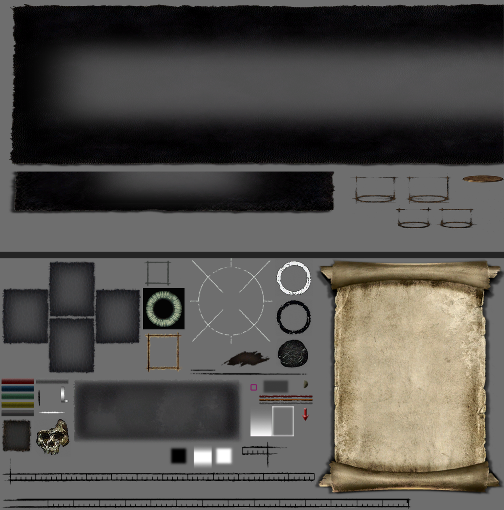
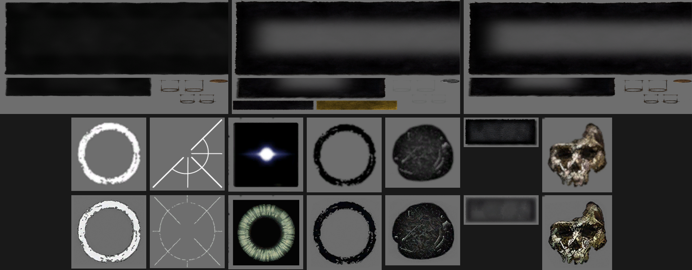

# Better User Interface — for Dark Souls: Remastered

**v1.0 · texture-only · 界面整合贴图包**

把 **Silver UI** 的界面皮肤、半透明面板，和 **UI Icon Remake** 的图标美术合成一个包：界面用银色的，图标用高清的，不用再二选一。
Silver UI's menu skin and translucent panels combined with the UI Icon Remake's icons — one pack, no more choosing between them.

for Dark Souls: Remastered (PC) · install with DSR-TPUP.

## 预览 / Preview

上：物品/装备菜单面板（`menu_3\menu07_7.dds`）；下：菜单图集（`menu_1\Menu08.dds`）。
Top: equipment-menu panels. Bottom: the menu atlas.

上排三个面板 = 原 UI Icon Remake / 原 Silver UI / 本包；下两排 = 七个菜单元素，上为原 Silver UI、下为本包。
Top row: original Icon Remake, original Silver UI, this pack. Bottom rows: seven menu elements — original Silver UI above, this pack below.

## 安装 / Installation

需要 **DSR Texture Packer & Unpacker (DSR-TPUP) 1.5**。

1. 关闭游戏。/ Close the game.
2. 备份 `<游戏目录>\menu\`（TPUP 也会自己留 `.tpupbak`）。/ Back up `<game>\menu\`; TPUP also writes `.tpupbak` copies.
3. 把 DSR-TPUP 的 **Texture Override** 指向本包的 `Texture Override` 文件夹。/ Point DSR-TPUP's **Texture Override** at this pack's `Texture Override`.
4. 点 **Pack**，启动游戏。/ Click **Pack**, launch the game.

**还原 / Restore**：TPUP 的 **Restore**，或把 `menu\menu_*.tpf.dcx` 旁边的 `.tpupbak` 改回原名。/ Use TPUP's **Restore**, or rename the `.tpupbak` files back.

## 内容 / Contents

20 张 BC3(DXT5) 贴图，与两个原包同名同路径，可直接互相替换 / 20 BC3 (DXT5) textures, same names and paths as both source packs:

| 目录 / Folder | 数量 / Files | 内容 / What it is |
|---|---|---|
| `menu\menu_0` | 7 | 菜单底纹与图标 / menu backdrops and icons |
| `menu\menu_1` | 4 | 菜单元素、血条图集 / menu elements, health-bar atlas |
| `menu\menu_2` | 2 | 菜单面板 / menu panels |
| `menu\menu_3` | 7 | 图标集、物品菜单 / icon sets, item menu |

## 合并方式 / How it was merged

- `menu_3\menu07_7.dds` — 两块大面板取 Silver UI，其余元素取 UI Icon Remake。
- `menu_1\Menu08.dds` — 七个菜单元素（白环、准星圆、方框内图标、暗环、暗石、大面板、小骷髅）取 UI Icon Remake，其余取 Silver UI。
- 两处都是按 alpha 轮廓对齐后整块替换（含透明度），没有混色；未改动的 4×4 压缩块逐个从原文件回填，除这几块以外整张图逐字节不变。
- 其余 18 张按贴图逐张选了两边更好的一版，未做混合。

- `menu07_7.dds`: both large panels from Silver UI, everything else from UI Icon Remake.
- `Menu08.dds`: those seven elements from UI Icon Remake, everything else from Silver UI.
- Both edits replace whole regions (alpha included, no blending); every untouched BC3 block was copied back from the original file, so the rest of each atlas is byte-identical.
- The other 18 textures are one pack's version picked per file, not blended.

## 注意 / Notes

- 只含贴图，**不含** `menu.drb.dcx`：HUD 的位置与粗细仍由布局类 mod 决定。/ Textures only — no `menu.drb.dcx`, so layout mods still own geometry.
- 与其它改 `menu_*.tpf.dcx` 的贴图包互斥，后 Pack 的生效。/ Conflicts with other `menu_*.tpf.dcx` packs; last one packed wins.
- 纯贴图替换：不动存档、不动参数，不影响联机判定。/ Texture-only: no save or param changes.
- 兼容 DSR 官方最新补丁。/ Works on the current official patch.

## 致谢 / Credits

- **Silver UI + Lock-on + Bow Aim + Translucent** — Nexus Mods, Dark Souls: Remastered, mod 39. Art by its original author.
- **UI Icon Remake** — Nexus Mods, Dark Souls: Remastered, mod 667. Art by its original author.
- 本包只做两套贴图之间逐元素的像素拣选与对齐；全部美术版权归上述原作者，可自由合并与二次修改，但请保留这两条链接。/ This pack only picks and aligns pixels between the two sets; all art belongs to the authors above. Free to merge and re-edit — keep the two links.
- Dark Souls: Remastered © FromSoftware / Bandai Namco. 本项目与二者无关联 / Not affiliated with FromSoftware or Bandai Namco.
